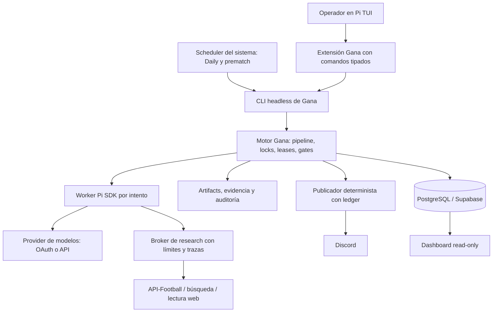

# Migración de Gana v9 al harness Pi

Fecha: **2026-10-13**, America/Guatemala  
Estado: **estudio terminado; implementación y cutover pendientes**  
Base inspeccionada: Gana `65ab484`; Pi `1.2.0`, commit `06a466935536f8c9bcacb2d5efc0fc021be1bdff`

## 1. Decisión propuesta

**La migración es técnicamente viable mediante una sustitución gradual de la capa de agente, conservando el motor de Gana. Todavía no está demostrada la paridad productiva**

Pi debe asumir el loop de agente, la interfaz interactiva, las sesiones nuevas y la integración con modelos y herramientas. Gana debe conservar la selección deportiva, los contratos de salida, la evidencia, los gates, PostgreSQL, el control de trabajos y el ledger de publicación. Esas piezas contienen el comportamiento del producto y no tienen un reemplazo equivalente en Pi

La ruta recomendada usa el **SDK de `@earendil-works/pi-coding-agent@1.2.0`**, con trabajadores de inferencia aislados y una extensión local para la TUI. Mantener `codex exec` como rollback temporal; retirarlo después de comprobar la sustitución. Retirar también Hermes de scheduling y transporte en una fase separada, para alcanzar independencia operativa completa

No recomiendo reescribir Gana como un conjunto de prompts, trasladar su DB a sesiones de Pi ni introducir Pi Durable en el primer corte. Pi Durable merece un experimento posterior, pero agrega otra máquina de estados donde Gana ya tiene leases, recuperación, idempotencia y un historial publicado

El plan conserva por defecto los modelos actuales: **Sol high para Daily; Astra medium para prematch y strategy review**. Cambiar harness y modelos simultáneamente impediría atribuir las diferencias. Su presencia en el catálogo Pi fue verificada; el acceso de esta cuenta a través de Pi no se probó

### Entregables complementarios

- [Credenciales, configuración, estado y operación](pi-migration-2026-10-13/secretos-y-operacion.md)
- [Evidencia y límites de la verificación](pi-migration-2026-10-13/evidencia.md)
- [Inventario de variables sin valores](pi-migration-2026-10-13/inventario-entorno.json)
- [Smoke offline reproducible del SDK](pi-migration-2026-10-13/pi-sdk-smoke.mjs)
- [Criterios de la meta](pi-migration-2026-10-13/GOAL.md)

## 2. Qué se comprobó y qué significa “todo el proyecto”

Se inspeccionaron las fronteras de agente, configuración, herramientas, evidencia, scoring, Daily, prematch, estrategia, persistencia, permisos, sesiones, programación y publicación. La evidencia está apoyada en código y configuración local; la documentación histórica se usó como contexto y se contrastó con el checkout

El inventario mecánico de `src/` contiene **258 archivos y 66.977 líneas**, incluyendo pruebas. `scripts/` agrega **73 archivos y 21.881 líneas**. Hay **18 contratos de prompt**. Esos conteos no estiman el esfuerzo ni implican que todas las líneas se leyeron. La búsqueda sobre código/documentos de producción seleccionados encontró menciones de Codex en 38 archivos, OpenRouter en 23 y Hermes en 10

“Todo” incluye operar el producto desde Pi y dejar de depender obligatoriamente del harness Codex, de la TUI antigua y del runtime Hermes. No significa reemplazar Prisma, API-Football, las reglas de negocio o el dashboard por funcionalidades inexistentes en Pi. Tampoco autoriza copiar todas las integraciones personales de Codex Desktop a otro cliente

### Estado local observado

| Área | Observación | Consecuencia |
|---|---|---|
| Agente interactivo | `.env` y `agent.config.json`: Codex, `gpt-6-astra`, medium, fast false | La configuración del operador difiere del Daily |
| Daily | `gpt-5.6-sol`, high, concurrencia de providers 1, `portfolio-v2`, web live | Mantener este perfil en la comparación |
| Prematch | `astra-prematch-v1`, ventana 120–20 minutos antes del kickoff, hasta 4 fixtures/pasada y 2 intentos/fixture | Migración obligatoria; no es un extra del Daily |
| Strategy | Codex Astra medium forzado en servicio y wrapper | No basta cambiar `AGENT_PROVIDER` |
| Scheduler | Hermes registra dos jobs habilitados: Daily en 07:15/10:15/13:15/18:15/22:15 y prematch cada 15 minutos | Migrar ambos a una única autoridad de scheduling |
| Otros schedulers locales | Sin jobs Gana cargados en launchd ni líneas Gana activas en crontab; no se encontraron automations locales Gana en el directorio inspeccionado | No prueba ausencia de otros hosts o almacenamiento cloud |
| DB | Prisma PostgreSQL, `DATABASE_URL` y `DIRECT_URL` presentes | No se consultó la DB ni se comprobó vigencia de acceso |
| Archivos operativos | 62.238 archivos, 2.092.368.768 bytes bajo `.artifacts/gana-v9`; 27 archivos bajo `.sessions` | El estado fuera de Git forma parte del respaldo |
| Credenciales | API-Football, Browser Use y DB presentes; auth Codex presente; auth Pi ausente; OpenRouter vacío | OAuth Pi y búsqueda web son gates previos al canary |

Los conteos de archivos y registros de scheduler son una fotografía local, no un diagnóstico de salud de los procesos. El `GOAL.md` de la raíz conserva incidentes anteriores y no se sobrescribió. Se preservaron cambios ajenos en arquitectura, diagramas y bitácora de estrategia

## 3. Pi evaluado, sin depender de información antigua

La página oficial anuncia Pi 1.0 desde el 1 de octubre de 2026. Durante el estudio, npm y el tag oficial coincidían en **1.2.0**. El paquete requiere Node `>=22.19.0`; el host tiene `22.22.3`. La licencia declarada es MIT. Las referencias fijadas a commit al final evitan depender del movimiento de `/latest`

| Capacidad de Pi 1.2.0 | Encaje en Gana | Límite que debe resolverse |
|---|---|---|
| SDK TypeScript `createAgentSession` | Sustituir `runCodexAgent` y el loop OpenRouter | Adaptar eventos, errores, cancelación, uso y cierre definitivo |
| TUI, comandos, extensiones | Operación asistida y mantenimiento | La TUI no reemplaza servicios ni jobs del dominio |
| Print/JSON y RPC | Alternativa para procesos externos e integraciones no Node | No equivalen a un scheduler durable ni a los contratos de salida de Gana |
| ModelRuntime y provider `openai-codex` | Conserva una ruta OAuth a los modelos actuales | El login de Codex no se importa automáticamente; requiere autenticación y canary propios |
| Herramientas y eventos de extensión | Reutilizar políticas y registries | Cambian los schemas y las firmas de ejecución |
| Skills estándar y `.agents/skills` | Reusar runbooks con adaptaciones | Los contratos `skills/*/skill.json` no son skills Pi descubribles |
| MCP y Codemode integrados en CLI | Integraciones puntuales | En SDK deben agregarse explícitamente; no importar todos los conectores por defecto |
| Árbol de sesiones y compaction | Sesiones del operador | No sustituye artifacts, evidencias, locks ni ledger |
| Trust del proyecto | Controlar qué recursos se cargan | No es un sandbox ni un sistema de aprobación de acciones |
| Pi Durable | Posible investigación futura | Paquete experimental separado; APIs y persistencia diferentes |

Fuentes: [lanzamiento](https://earendil.com/posts/pi-1-0/), [SDK](https://pi.dev/docs/latest/sdk), [seguridad](https://pi.dev/docs/latest/security), [MCP](https://pi.dev/docs/latest/mcp). El catálogo empaquetado y las firmas se contrastaron localmente contra Pi 1.2.0

### Alternativas evaluadas

| Opción | Ventaja | Costo/riesgo | Decisión |
|---|---|---|---|
| Pi TUI ejecutando la CLI actual | Inicio sencillo; útil como panel operativo | Sigue dependiendo de Codex por dentro | Puente inicial, no criterio de migración completa |
| SDK Pi dentro de un worker controlado por Gana | Contratos claros, tipos, herramientas restringidas y proceso cancelable | Requiere adaptador y broker para capacidades externas | **Destino recomendado** |
| Pi RPC como backend de inferencia | Aislamiento de proceso y protocolo público | Más adaptación de eventos, trust, configuración y salidas | Alternativa si se prioriza integración fuera de Node |
| Solo `pi-ai`/`pi-agent-core` | Menos capas para inferencia | Habría que reconstruir parte del harness y de los recursos Pi | No como ruta principal solicitada |
| Pi Durable desde el primer día | Persistencia de conversación y tareas | Dobles estados, nuevo contrato de recuperación y fase experimental | Diferir a un ADR posterior |
| Reescribir reglas como skills/prompts | Aparente simplificación | Pérdida de garantías deterministas y trazabilidad | Descartar |

## 4. Qué rescatar, adaptar y retirar

| Componente actual | Acción | Trabajo concreto y verificador |
|---|---|---|
| `src/domain`, `filters`, `markets`, `scoring` | **Conservar** | Mismos identificadores, normalización, devig, calibración, correlación y gates; replays idénticos con entradas congeladas |
| `src/providers/sports` y presets | **Conservar** | API-Football, snapshots, rate limits, temporadas y ligas; no pedirle al LLM que reimplemente el fetch |
| `src/evidence`, `retrieval` | **Conservar y adaptar llamada** | Mantener claims, cutoff, freshness y provenance; reemplazar trazado específico de `web_search` |
| `src/prediction`, `parlay`, `council`, `recommendations` | **Conservar y adaptar contrato** | Mismo schema, gates, perfiles y abstenciones; resultados Pi entran por validación actual |
| `src/validation`, `metrics`, `analytics` | **Conservar** | Settlement, cohortes publicadas, Brier/logloss/CLV y feedback; sin recalcular historia al cambiar harness |
| `src/daily` | **Adaptar** | Allowlist Codex-only, familias, defaults y prematch; separar identidad de harness/modelo |
| `src/strategy-review/daily.ts` | **Adaptar** | Eliminar hardcode de backend tras paridad; mantener proposals y revisión humana de implementación |
| `src/runtime` | **Conservar** | Pipeline, presupuestos, propietario del run, leases, idempotencia y recuperación siguen siendo autoridad |
| `src/storage`, `prisma` | **Conservar** | Tablas, relaciones, UUIDs y migraciones; agregar metadata de ejecución sin reescribir filas históricas |
| `src/public-recommendations` y ledger | **Conservar** | Solo lo realmente publicado alimenta el historial; identidad y hashes estables |
| `src/dashboard` | **Conservar y adaptar lectura** | Mostrar backend/modelProvider por separado; seguir leyendo artifacts antiguos |
| `src/agent.ts`, `providers/agentic` | **Reemplazar gradualmente** | Fachada compatible más adaptador Pi; sacar ejecución de subprocess Codex al final |
| `src/tools` | **Adaptar** | Separar ejecución/policy del constructor OpenRouter; schemas Pi TypeBox con validación Zod existente |
| `src/permissions`, `security`, `observability` | **Conservar y ampliar cobertura** | Todas las herramientas Pi, incluidas anidadas/MCP, pasan por enforcement, redacción y auditoría |
| `src/cli.ts`, `commands.ts`, renderer/input/loader | **Retirar superficie interactiva al final** | Pi TUI y comandos operativos reemplazan la interacción; preservar CLI headless para scheduler |
| `src/headless.ts`, `commands/runners.ts` | **Conservar** | API estable del motor para extensiones y jobs; no reemplazar scripts deterministas por prompts libres |
| `src/session.ts`, `.sessions` | **Archivar historia; sesiones nuevas en Pi** | Conversión opcional de user/assistant redactados; nunca fingir un resume de thread Codex en Pi |
| `.agents/skills` pertinentes | **Rescatar** | Daily ops, notifier y strategy-review; actualizar referencias a tools/runtimes; ultragoal requiere comandos realmente implementados |
| `skills/*` | **Conservar los 18 contratos** | Prompts, JSON Schema, manifests y hashes siguen en su ruta; no convertirlos en texto informal |
| Notifier `.agents/skills/discord-recommendation-notifier` | **Conservar lógica, reemplazar transporte** | Mantener embeds/paginación/targets/ledger; sacar Python y gateway Hermes del envío |
| `scripts/gana-telegram-rich-output.mjs` y delivery del cron | **Conservar rendering; desacoplar si está activo** | Preservar resúmenes/alertas y routing; su fallback Bot API también usa Python/Hermes. El instalador declara jobs `--no-agent` |
| Scripts cron, revisiones y retención | **Conservar y desacoplar** | Un scheduler del sistema ejecuta wrappers; cambiar autenticación/launchers y completar prematch |
| `config/codex-models.json`, scripts de catálogo | **Archivar al retirar Codex** | Sustituir por catálogo Pi validado y perfiles versionados; no usar fallback silencioso |
| `.artifacts`, locks y receipts | **Rescatar como estado operativo** | Backup, checksums, restauración y compatibilidad; no importarlos masivamente al contexto Pi |
| Scripts raíz experimentales y outputs sueltos | **Cuarentena/archivo tras comprobar referencias** | No integrarlos automáticamente ni borrarlos por su nombre; distinguir prototipos del flujo canónico |
| Docs históricos/Notion y migraciones MySQL legacy | **Conservar como referencia** | No reactivar fuentes históricas ni restaurar credenciales retiradas |
| Plugins/servicios propios de Codex Desktop | **Fuera del runtime Gana salvo dependencia demostrada** | Goals, interfaz de aprobación, artifacts del app y conectores no se transfieren por copiar SKILL.md |

El `@openrouter/agent` actual no se puede borrar al agregar Pi: todavía construye las herramientas y sostiene el fallback. Se retira cuando ninguna ruta ejecutable lo importe; usar modelos OpenRouter desde Pi es una decisión independiente

## 5. Arquitectura objetivo

### Contrato del adaptador

La fachada `runAgent` puede mantenerse mientras se extraen implementaciones. El adaptador Pi debe recibir configuración inmutable, prompt, schema esperado, run/task/attempt IDs, límite de tiempo, señal de cancelación, herramientas permitidas y observador de eventos

Debe devolver únicamente el resultado final validado, uso, backend/modelProvider/modelo realmente usados, ID de sesión nuevo, stop reason y trazas de herramientas. No concatenar mensajes intermedios con la respuesta JSON. En Pi, `agent_end` puede preceder reintentos o trabajo encolado: usar el término de `prompt()` y el estado asentado, examinando errores/abortos y `message_end` para la respuesta final

Una sesión por intento estructurado. Research/scoring no comparten conversaciones entre fixtures. Los workers usan `SessionManager.inMemory()` inicialmente; Gana persiste el resultado redactado. La TUI sí puede conservar sesiones Pi, bajo política específica. No copiar `codexThreadId` a un supuesto ID Pi

El proceso coordinador conserva DB, API-Football, locks y publicación. Los workers reciben solo contexto necesario y herramientas específicas; no heredan `...process.env`, no ven `DATABASE_URL`, `DIRECT_URL` ni tokens Discord. El modelo necesita sus credenciales de transporte, pero esas credenciales nunca son herramientas, prompt o resultado. Usar un loader explícito y una allowlist, no descubrimiento automático del home del operador

Para research, un broker puede atender solicitudes de búsqueda y lectura con límites por run. Para scoring/parlay, iniciar con ninguna herramienta general y el mecanismo de salida estructurada. Cancelación debe cerrar la sesión, detener el worker y sus descendientes, y dejar el run en un estado recuperable. Los límites de retry del SDK y del servicio deben coordinarse para no multiplicarse

### Nombres y compatibilidad

Propuesta mínima para la transición: ampliar el discriminante actual con `provider: 'pi'` y agregar `piModelProvider`, conservando lectura de `codex` y `openrouter`. `model` sigue identificando el modelo real. Registrar también `agentHarness`, `agentHarnessVersion`, `modelProvider`, `reasoningRequested`, `reasoningEffective`, `attempt` y hashes de contratos/configuración

No marcar un resultado Pi como `providerAgentic=codex` por usar OAuth `openai-codex`. Pi identifica el harness; `openai-codex` identifica el transporte/model provider. Las columnas Prisma de provider/model son strings, pero los tipos TS y schemas Zod sí tienen allowlists que deben ampliarse. Los campos nuevos pueden iniciar en metadata JSON versionada; una migración SQL solo si el diseño final requiere consultarlos como columnas

En artifacts nuevos, reemplazar etiquetas rígidas `codex-only` por una familia explícita Pi; mantener deserialización de familias antiguas. No contar dos harnesses sobre el mismo modelo como fuentes independientes de un ensemble

## 6. Brechas que pueden bloquear el cutover

### B1. Research web equivalente

Gana detecta eventos de `codex exec` llamados `web_search`, y exige su uso para investigación live. La implementación Pi 1.2.0 inspeccionada convierte herramientas de función; no encontramos una herramienta de búsqueda web lista para reemplazar ese contrato. La opción `json_schema` localizada en los tipos corresponde a restricciones de herramientas, no a una garantía general de salida JSON final

Agregar `provider='pi'` sin cambiar el enforcement puede provocar que `deriveNativeWebSearchRequirement` calcule `required=false`, porque hoy depende de que el provider esté marcado como soportado. **Eso sería una regresión de seguridad y de calidad**, aunque el pipeline termine verde

Implementar una capacidad de research verificable: llamada real con ID, query, URLs, hora de captura, corte temporal, contenido/provenance y estado de éxito. Reusar Browser Use como proveedor de evidencia puede ayudar, pero su disponibilidad actual no demuestra cobertura ni costo equivalente a la búsqueda nativa. Evaluar un conector de búsqueda explícito; proveedor y presupuesto quedan como gate de P1

Un puente temporal puede mantener research en Codex mientras scoring pasa a Pi. Debe etiquetarse como migración parcial. No falsificar eventos ni llamar `web_search` a una función que devuelve texto generado. Si se experimenta con `onPayload` para herramientas hosted, verificar además su salida y eventos en el parser: inyectar un campo de request no prueba compatibilidad

### B2. JSON estructurado y equivalencia de schemas

Codex usa `--output-schema` y `--output-last-message`; Gana valida y reintenta. Pi no ofrece un reemplazo directo verificado para esos dos flags. Diseñar un `submit_structured_result` con schema de herramienta o un adaptador de respuesta del proveedor, más validación local obligatoria antes de persistir

La conversión JSON Schema/Zod/TypeBox debe probar unions, nullability, required, additionalProperties y refinamientos. Los refinamientos de negocio permanecen en Zod/servicios aunque el proveedor acepte el schema. Error, truncamiento, aborto o JSON inválido no pueden producir un artifact promotable. Mantener límites de intentos y registrar el fallo, sin reparaciones ilimitadas

### B3. Modelos, OAuth y razonamiento

Se verificó que el catálogo Pi incluye Sol y Astra bajo `openai-codex`, y que una sesión acepta Sol high. No se probó login, refresh de tokens, rate limits, disponibilidad por cuenta ni inferencia. `ultra` aparece en Gana pero no en el tipo de razonamiento Pi inspeccionado: rechazarlo como incompatibilidad hasta resolverlo, sin reducirlo silenciosamente

Pi ofrece una autenticación propia; no convertir ni copiar a mano `~/.codex/auth.json`. La alternativa API tiene facturación propia y requiere una decisión de presupuesto. No asumir que una suscripción transfiere límites o habilita todas las APIs. El fallback debe permanecer explícito y observable

### B4. Permisos y redacción reales

Hoy `createTools()` envuelve herramientas OpenRouter con políticas; la ruta Codex usa su subprocess y sandbox. Por lo tanto, no se debe afirmar que las políticas locales ya cubren todas las herramientas nativas. Pi ejecuta con permisos del proceso; `cwd`, trust y un prompt restrictivo no aportan aislamiento del sistema operativo

Extraer un ejecutor protegido reutilizable. Aplicar política antes de ejecución y redacción antes de devolver/persistir. Mantener no-monetary-actions, approvals y audit; ampliar rutas sensibles para auth/MCP/sesiones Pi y Hermes. Cubrir contenido, argumentos, errores, `details`, `structuredContent`, streaming, compaction y herramientas anidadas. Probar que cambiar el nombre de una herramienta o entrar por Codemode/MCP no evita las mismas restricciones

La TUI de desarrollo y el worker productivo deben tener perfiles distintos. El worker productivo no necesita shell, edición de archivos, herramientas monetarias ni publicador Discord a disposición del modelo. Las extensiones aprobadas son código de confianza; para restringir ese código se necesita aislamiento de proceso/OS y control de egress

### B5. Durabilidad y efectos externos

El historial de sesión Pi no es el historial transaccional del producto. Mantener `withRunLifecycleOwnership`, leases, CAS y claves idempotentes. Una caída tras enviar Discord y antes de guardar un receipt debe conservar `publication-uncertain`, sin reenvío automático

Pi Durable no elimina ese problema de entrega externa. Su `requestId` no vuelve exactamente-una-vez el endpoint Discord. La documentación del paquete inspeccionado indica un único proceso propietario por storage y ausencia de locking entre procesos; no compartirlo como reemplazo improvisado de la cola PostgreSQL

### B6. Independencia de Hermes

`sendDiscordNativePayload` usa `HERMES_GATEWAY_PYTHON`, importa módulos del gateway, lee `~/.hermes/.env` y resuelve su configuración. Reemplazarlo por cliente HTTP tipado en Node detrás de la misma interfaz, sin tocar la preparación/reserva del payload ni el ledger

El instalador launchd actual contempla Daily, pero no el job prematch nuevo. Completar esa cobertura y verificar timezone, PATH, repositorio, ausencia de solapamientos, recuperación tras suspensión del host y monitorización. La TUI Pi no debe quedarse abierta para que los jobs funcionen

Preservar también las alertas/resúmenes entregados por `--deliver` de Hermes. Reemplazar solo el scheduler puede dejar el proceso ejecutándose y perder sus avisos. Si Telegram directo no está activo, no transferir su bot por defecto; si lo está, el transporte y la allowlist forman parte del mismo cutover

## 7. Plan de implementación por entregas

Las rutas de archivos nuevos y flags en esta sección son **propuestas**, no funcionalidades que ya existan. Cada entrega termina en un diff revisable con evidencia

| Fase / dueño sugerido | Trabajo y rutas | Dependencia | Aceptación | Esfuerzo estimado |
|---|---|---|---|---|
| P0 — responsable técnico/operador | Fijar Pi 1.2.0 y toolchain; snapshot DB/estado; registrar baseline; ADR del adaptador y perfiles | Estudio | Inventario restaurable, versiones exactas y gates de canary definidos | 1–2 días |
| P1 — integración | Spike fuera de producción: OAuth Pi, research web, salida estructurada, error/abort, herramientas y costos | P0 | Sol high + Astra medium accesibles; evidencia web auténtica; schemas correctos; sin fuga; decisión go/no-go | 3–5 días |
| P2 — backend | Extraer fachada en `src/providers/agentic`; agregar adaptador/worker Pi y configuración; conservar Codex | P1 | Contract tests contra ambos backends; timeouts cancelan todo; settings reproducibles y provenance completa | 3–5 días |
| P3 — seguridad/herramientas | Desacoplar OpenRouter en `src/tools`; ejecutor común; broker; aislamiento; redacción integral | P2 | Pruebas adversariales, sin shell/secretos/canales en workers; políticas equivalentes | 3–5 días |
| P4 — dominio | Ampliar schemas/types; migrar research/scoring/parlay/Daily/refresh/strategy y dashboard | P2–P3 | Todos los perfiles operan con Pi; lectura legacy y replays conservados; contratos intactos | 3–5 días |
| P5 — experiencia/operaciones | `.pi/extensions/gana.ts` propuesta; comandos tipados; skills; sesiones y docs del operador | P3–P4 | Flujos representativos desde Pi TUI y ejecución headless sin depender de TUI antigua | 2–4 días |
| P6 — operación independiente | Transporte Discord Node, scheduler Daily + prematch, configuración fuera de Hermes | P4; puede prepararse con P5 | Payloads equivalentes; dry-run sin efectos; un solo dueño por job; tests de caída/publicación incierta | 3–5 días |
| P7 — QA/operador | Replays, comparación live acotada, shadow, canary, cutover y rollback ensayado | P4–P6 | Gates de sección 8, artefactos auditables y primera validación de publicaciones Pi | 2–4 días activos + observación |
| P8 — responsable técnico | Retirar dependencias obligatorias Codex/OpenRouter-agent/Hermes y TUI vieja; actualizar docs | P7 estable | Criterio de finalización de sección 10 y rollback documentado | 1–2 días |

Estimación de planificación: **21–37 días de ingeniería**, aproximadamente 4–8 semanas para una persona, más una ventana sugerida de siete días de observación. No es una cotización ni un benchmark. B1/B2 pueden ampliar el plazo; P1 debe resolver esa incertidumbre antes del refactor amplio

### Orden práctico de PRs

1. ADR, configuración/versiones y fixtures de paridad; ninguna ruta productiva cambia
2. Adaptador Pi opt-in, contratos de eventos/errores/uso y capacidad de salida estructurada
3. Herramientas/policies/broker de investigación y aislamiento
4. Integración de todos los flujos, schemas y provenance; comparación en shadow
5. Extensión TUI, skills y runbook del operador
6. Publicador independiente y scheduler con prematch; cutover reversible
7. Retirada legacy tras aceptación y observación

P1 puede preceder los PRs de implementación con un spike descartable. Si un gate falla, corregir el adaptador o conservar el backend anterior; no modificar goldens, requisitos de evidencia ni umbrales para disimular la diferencia

### Lista inicial de cambios por frontera

| Frontera | Archivos que revisar en el PR |
|---|---|
| Provider/config | `src/config.ts`, `src/agent.ts`, `src/providers/agentic/{types,helpers}.ts`, `src/runtime/{context,events}.ts`, `agent.config.json`, `.env.example` |
| Schemas/provenance | `src/evidence/types.ts`, `src/daily/{types,comparison,e2e}.ts`, `src/storage/types.ts`, repositorios y `src/dashboard` |
| Research/model output | `src/evidence/research.ts`, `src/prediction/service.ts`, `src/parlay/service.ts`, `src/evals/runner.ts` |
| Perfiles completos | `src/daily/{runtime-defaults,pre-match-policy,refresh}.ts`, `src/strategy-review/daily.ts`, `scripts/lib/daily-e2e-runtime.mjs`, wrappers Daily/strategy/prematch |
| Herramientas/seguridad | `src/tools/{index,registry,schemas}.ts` y ejecutores, `src/permissions/{policy,egress-policy,redaction,tool-metadata}.ts`, `src/session.ts` |
| Interfaz/operación | `src/{cli,commands,headless}.ts`, `src/commands/{flags,runners}.ts`, extensión Pi propuesta, instaladores y notifiers |

La extensión puede exponer `/gana-status`, `/gana-run`, `/gana-daily`, `/gana-validate`,
`/gana-metrics` y `/gana-artifacts` como comandos nuevos sobre los runners tipados.
Son nombres propuestos: validar argumentos, fechas absolutas y alcance autorizado;
no interpolar texto del usuario en shell. Mantener headless como interfaz estable
del scheduler. La política de operación distingue inspección, cálculo y publicación
para que una solicitud de estado no dispare efectos externos

## 8. Verificación y gates de aceptación

| Gate | Evidencia requerida antes de avanzar |
|---|---|
| G0 — baseline | Typecheck, tests existentes relevantes, replay/certificación, hashes de los 18 prompts y snapshot de artifacts/DB restaurable |
| G1 — acceso/modelos | Login Pi propio; llamada acotada de Sol high y Astra medium; refresh/reinicio; provider/model/effort efectivos registrados |
| G2 — research | Cada solicitud live tiene una traza real y fuentes válidas; `web: off` no se promociona como live; falla de búsqueda produce abstención visible |
| G3 — estructura | Todos los fixtures del corpus producen schema válido o fallo tipado; cero persistencias/promociones de JSON inválido; respuesta final separada del streaming |
| G4 — seguridad | Cero ejecución monetaria, fugas o bypass de rutas/egress; tests con señuelos, shell ausente en worker, fallos de hooks y herramientas anidadas |
| G5 — replay | Igualdad exacta en settlement, mercados, gates, ledger y payloads con las mismas salidas de modelo congeladas; no exige identidad de texto LLM live |
| G6 — calidad live | Comparación en cohortes congeladas y prospectivas, mismos datos/modelo/esfuerzo; revisión de discrepancias, cobertura y abstenciones; ningún blocker convertido en aprobado |
| G7 — operaciones | Daily y prematch disparan con timezone correcto; límites, leases, retry/catch-up y cancelación; pruebas de caída antes/después de reserva/envío/receipt |
| G8 — publicación | Payload dry-run equivalente, lineage exacto, cero duplicados y estado incierto sin reenvío; canary externo autorizado y receipt/readback |
| G9 — continuidad | Restauración y rollback ensayados; validación lee publicaciones previas al corte y las nuevas; monitorización sin fallos críticos en ventana acordada |

### Corpus y límites propuestos para P1/P7

Congelar al menos 20 casos representativos: fixture normal, odds faltantes/stale, lineup pendiente/confirmado, evidencia conflictiva, mercados sensibles, no elegible, revisión, y kickoff vencido. Agregar fallos de JSON, timeout, cancelación, cuota, red y publicación parcial. Para resultados del modelo, medir diferencias; para las funciones deterministas, exigir igualdad con la misma entrada

Hacer un canary de 1–3 fixtures, luego una fecha en shadow y al menos tres slates diarios completos antes de considerar el corte. La ausencia legítima de picks debe quedar explicada; fabricar picks para cumplir un mínimo está prohibido. Revisión inicial sugerida: latencia p95 y consumo no más de 20% sobre baseline equivalente; acordar el margen tras P1, porque todavía no existe una medición comparable

No afirmar mejora de ROI ni calibración con tres días. Medir schema failures, fuentes válidas, abstención por motivo, promociones bloqueadas, p50/p95, tokens/cache, reintentos y costo observable. Evaluar Brier/logloss/CLV cuando la cohorte tenga resultados completos y tamaño suficiente

### Presupuesto

Pi no elimina el costo de modelos, búsqueda, API-Football, infraestructura o mantenimiento. Estimar por flujo:

`costo diario = research + scoring + parlay + prematch + strategy + búsqueda + datos + infraestructura`

Para cada llamada usar tokens facturados, cache y tarifa efectiva del provider; para OAuth, registrar consumo/cuotas aunque no exista costo marginal por llamada. No convertir precios de catálogo en una factura observada. El `maxCost` de OpenRouter no protege automáticamente el nuevo backend y no se aplica igual en la ruta Codex actual: implementar límites del coordinador por intento/run/día antes de habilitar lotes amplios

## 9. Transición, estado y rollback

1. **Preparar sin alterar producción:** conservar cambios ajenos; rama propuesta `codex/migrate-gana-to-pi`; pin de versiones/lockfile; snapshot y restauración probada; credenciales Pi fuera del repo
2. **Opt-in por flujo:** nuevos flags/backend desactivados por defecto. Migrar scoring/parlay/strategy tras sus gates; research solo después de B1. Etiquetar cualquier modo mixto
3. **Shadow aislado:** otra DB/schema con permisos propios, artifact root separado, IDs propios y publicación deshabilitada por código. `GANA_ARTIFACT_ROOT` por sí solo no aísla escrituras DB ni Discord. Las banderas propuestas de shadow aún no existen
4. **Comparar y aceptar:** registrar configs, hashes, modelos, costos, errores y diferencias; no usar datos posteriores al cutoff para demostrar calidad prematch histórica
5. **Ventana de cutover autorizada:** activar mantenimiento, detener admisión de ambos jobs, drenar procesos, reconciliar locks y entregas inciertas; tomar backup final coherente
6. **Transferir autoridad:** deshabilitar los dos jobs Gana de Hermes solo cuando el scheduler sustituto esté verificado. No desinstalar Hermes ni afectar sus otros bots. Si cambia el host, copiar estado inactivo, no mutex de procesos vivos
7. **Habilitar Pi:** un único escritor y publicador; dry-run del dispatcher y notifier; reanudar con límites acordados; primer envío canary y verificación de ledger/receipt; observar la validación posterior
8. **Observar y retirar:** ventana sugerida de siete días, incluyendo prematch, strategy, rollover y al menos un reinicio controlado. Retirar legacy después del cumplimiento de G9

Ante fuga, bypass, duplicación, schema defectuoso, falla repetida de research o recuperación incorrecta: pausar admisión y publicación, preservar evidencias y pasar al backend anterior con los mismos datos/ledger compatibles. No restaurar una DB antigua sobre publicaciones nuevas para “volver atrás”. El rollback de código debe poder leer artifacts Pi y conservar las publicaciones ya entregadas

Las configuraciones incompatibles se rechazan al arrancar. Conservar los perfiles legacy congelados y migraciones aditivas durante la ventana. Las credenciales antiguas permanecen privadas y disponibles para rollback hasta retirarlas deliberadamente

## 10. Cuándo podemos declarar terminada la migración

- El operador usa Pi para los flujos representativos de Gana y puede recuperar sesiones nuevas
- Daily, prematch, scoring, research, parlay y strategy usan el backend Pi aceptado, sin subprocess `codex exec`
- La CLI headless conserva dominio, validación, métricas, DB, dashboard y auditoría
- Ninguna ruta activa necesita `@openrouter/agent` ni Python/config/gateway de Hermes
- Daily y prematch tienen un único scheduler responsable y funcionan sin una TUI abierta
- Se pueden validar publicaciones históricas y nuevas con lineage y cohorts correctos
- Los secretos están disponibles solo para sus procesos autorizados; los artifacts/sesiones no los contienen
- G0–G9 tienen evidencia guardada; rollback y restauración están ensayados
- Documentación, skills, on-call/runbooks y dependencias reflejan la arquitectura final

Un wrapper que abre Pi pero sigue llamando Codex dentro del Daily no cumple este criterio. Tampoco lo cumple retirar el código viejo antes de probar research, publicación y validación

## 11. Decisiones para la fase de implementación

El estudio puede cerrarse con estas decisiones explicitadas; no requieren detener la investigación actual

| Decisión | Recomendación inicial | Momento límite |
|---|---|---|
| Host de operación | Mantener el Mac actual para evitar mezclar migración de harness e infraestructura; estudiar servidor siempre disponible aparte | P0 |
| Autenticación | Probar OAuth propio de Pi con `openai-codex`; API como alternativa con presupuesto explícito | P1 |
| Búsqueda live | Resolver con conector/broker verificable, midiendo cobertura y consumo; mantener puente Codex solo como transición | P1 |
| Persistencia Pi | Sesiones de workers en memoria y artifacts Gana redactados; sesiones del operador en store privado | P2 |
| Scheduler final | launchd en este Mac, con soporte adicional prematch y timezone comprobado; cron/systemd si se decide Linux | P6 |
| Costo/latencia aceptables | Medir P1 y acordar presupuesto antes de shadow live/canary | P7 |
| Pi Durable | Diferir; ADR separado únicamente si aparece una necesidad no cubierta por el runtime actual | Después de P8 |

## 12. Fuentes primarias fijadas y código local

Fuentes externas consultadas el 2026-10-13; la implementación debe releer el changelog si actualiza la versión

- [Paquete Pi 1.2.0, engines y dependencias](https://github.com/earendil-works/pi/blob/06a466935536f8c9bcacb2d5efc0fc021be1bdff/packages/coding-agent/package.json)
- [SDK y lifecycle](https://github.com/earendil-works/pi/blob/06a466935536f8c9bcacb2d5efc0fc021be1bdff/packages/coding-agent/docs/sdk.md)
- [Firmas reales de createAgentSession](https://github.com/earendil-works/pi/blob/06a466935536f8c9bcacb2d5efc0fc021be1bdff/packages/coding-agent/src/core/sdk.ts)
- [Extensiones y herramientas](https://github.com/earendil-works/pi/blob/06a466935536f8c9bcacb2d5efc0fc021be1bdff/packages/coding-agent/docs/extensions.md)
- [Autenticación de providers](https://github.com/earendil-works/pi/blob/06a466935536f8c9bcacb2d5efc0fc021be1bdff/packages/coding-agent/docs/providers.md)
- [Transporte openai-codex](https://github.com/earendil-works/pi/blob/06a466935536f8c9bcacb2d5efc0fc021be1bdff/packages/ai/src/api/openai-codex-responses.ts)
- [Skills](https://github.com/earendil-works/pi/blob/06a466935536f8c9bcacb2d5efc0fc021be1bdff/packages/coding-agent/docs/skills.md), [packages](https://github.com/earendil-works/pi/blob/06a466935536f8c9bcacb2d5efc0fc021be1bdff/packages/coding-agent/docs/packages.md) y [MCP](https://github.com/earendil-works/pi/blob/06a466935536f8c9bcacb2d5efc0fc021be1bdff/packages/coding-agent/docs/mcp.md)
- [Seguridad y trust](https://github.com/earendil-works/pi/blob/06a466935536f8c9bcacb2d5efc0fc021be1bdff/packages/coding-agent/docs/security.md)
- [Pi Durable y storage](https://github.com/earendil-works/pi/blob/06a466935536f8c9bcacb2d5efc0fc021be1bdff/packages/durable/README.md)

Anclas locales: [agente](../../src/agent.ts), [config](../../src/config.ts), [helpers de provider](../../src/providers/agentic/helpers.ts), [research](../../src/evidence/research.ts), [schemas de evidencia](../../src/evidence/types.ts), [Daily](../../src/daily/e2e.ts), [prematch](../../src/daily/pre-match-policy.ts), [strategy](../../src/strategy-review/daily.ts), [herramientas/policy](../../src/tools/index.ts), [schema DB](../../prisma/schema.prisma), [scheduler](../../scripts/lib/daily-ops-dispatch.mjs), [publicador Discord](../../.agents/skills/discord-recommendation-notifier/scripts/notify-discord-recommendations.mjs), [certificación](../../src/evals/runner.ts), [docs de skills](../skills.md)
